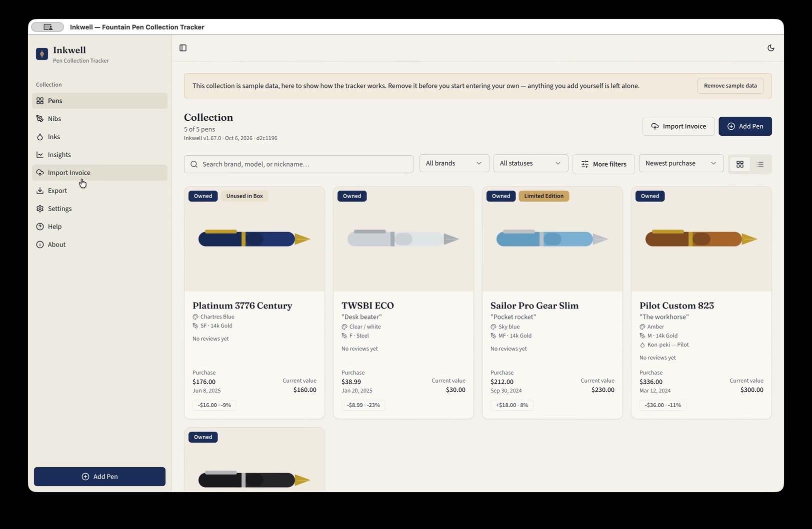

# Inkwell

A fountain pen collection tracker for your own computer. Your collection stays on your machine.

**Inkwell is in private testing, and these builds are for invited testers only.** If you were
sent here, thank you. Please don't pass this page or the downloads on; if someone else would like
to try it, ask them to get in touch at hello@inkwell-the-app.com. Inkwell is proprietary: receiving a
copy is for evaluation and gives no right to redistribute it.

**Open this page on the computer you're installing on.** If you scanned the QR code with your
phone, send yourself this address and open it there:
**github.com/robmcclure/inkwell-releases**

Current version: **1.69.0**

## See it first

A 7-minute tour of Inkwell, with no sound. It plays in your browser or on your phone.

**[Watch the demo](https://robmcclure.github.io/inkwell-releases/demo/)**

## Mac

[**Download for Mac**](https://github.com/robmcclure/inkwell-releases/releases/latest/download/Inkwell-mac-arm64.dmg)

- For Macs with Apple silicon (M1 or later).
- Open the download and drag Inkwell into Applications. It's signed and checked by Apple, so it
  opens without warnings.
- Before you start: read the [Mac testing guide](TESTING.md).

## Windows

[**Download for Windows**](https://github.com/robmcclure/inkwell-releases/releases/latest/download/Inkwell-Setup-windows-x64.exe)

- For 64-bit Windows 10 or 11.
- The installer isn't signed yet, so Windows shows **"Windows protected your PC"**. Click
  **More info**, then **Run anyway**. Only do this for a file you downloaded from this page.
- Before you start: read the [Windows testing guide](TESTING-WIN.md).

## Updates

Once installed, Inkwell checks this page for new versions and updates itself when you quit it.
You won't need to download it again.

## Checking your download

To confirm a download is exactly the published file, compare its SHA-256 fingerprint with the
one below. On a Mac: `shasum -a 256 <file>` in Terminal. On Windows: `certutil -hashfile <file>
SHA256` in Command Prompt.

- Mac (`Inkwell-mac-arm64.dmg`, 1.69.0): `d4610963df5244a004e9024e9cf1bb184147daaeda9a740e9570c7ad77b1d44c`
- Windows (`Inkwell-Setup-windows-x64.exe`, 1.69.0): `a14f9b63ffcc2ace8c0e0c69415fd3a1268428c07cf50439b3f8c02be89e0c8d`

## Privacy

GitHub counts how many times each file is downloaded. That number is all Inkwell's author sees:
no names, no IP addresses. The app itself sends nothing about you anywhere, and nothing about
your collection beyond what's described here. It goes online for four things only: checking this
page for updates; when you import an order, fetching the product photos that order links to from
the retailer's site; when you click Update from ECB in Settings, downloading the European Central
Bank's public exchange rates; and, when you click Look up properties, searching Vanness Pens and
Mountain of Ink for an ink, which sends them that ink's brand and colour and nothing else.

[All versions and release notes](https://github.com/robmcclure/inkwell-releases/releases)
